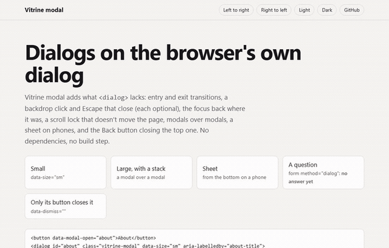

<!-- SPDX-License-Identifier: GPL-3.0-or-later -->
# Vitrine modal

**Dialogs on the browser's own `<dialog>`, with everything it lacks.** Entry and exit
transitions, the backdrop and Escape (each optional), the focus back where it was, modals over
modals, a sheet on phones, the Back button, and a scroll lock that doesn't move the page. Plain
JavaScript and CSS, no dependencies, no build step.

[**Live demo**](https://anefzaoui.github.io/vitrine-modal/) ·
[Right to left, dark](https://anefzaoui.github.io/vitrine-modal/?rtl&theme=dark) ·
[Vitrine](https://github.com/anefzaoui/vitrine), its sibling lightbox



## What it does

- Opens your `<dialog>` with `showModal()`: the browser makes the page behind inert, keeps the
  focus inside and stacks one modal over another on its top layer.
- Adds an **entry and an exit transition** (a fade and a short rise; a fade only with reduced
  motion), including when a `<form method="dialog">` closes it.
- Closes on a **click on the backdrop** (a press that starts and ends outside the dialog's box, so
  selecting text doesn't) and on **Escape**, each switchable per dialog.
- Gives the **focus back** to whatever opened it (or the modal under it).
- **Locks the page's scroll** without moving it: the scrollbar's room is kept and a sticky header
  stays put; the lock is counted, shared with [Vitrine](https://github.com/anefzaoui/vitrine).
- The phone's **Back button** closes the top modal instead of leaving the page.
- **Sizes**: `sm` (420 px), `md` (560 px), `lg` (880 px), and `sheet`, which rises from the bottom
  edge on a phone.

## Accessibility

It is the native modal dialog, so the roles, the inert page behind and the focus trap are the
browser's own. Name each dialog (`aria-labelledby` its heading); `[autofocus]` or
`[data-modal-focus]` inside picks where the focus starts. Right to left works with logical
properties throughout.

## Size and support

`vitrine-core.js` + `vitrine-modal.js` are 2.9 KB minified and gzipped, `vitrine-modal.css`
0.8 KB. Tested on every push in headless Chromium and Firefox (Playwright) at 360 to 1440 px,
light, dark, right to left, keyboard and reduced motion. Needs `<dialog>` with `showModal`:
Chrome and Edge, Firefox 98+, Safari 15.4+ (Safari isn't in the test run yet).

## Install

Copy `vitrine-core.js`, `vitrine-modal.js` and `vitrine-modal.css`, or load them from a pinned
commit or tag (no tags yet: use a commit SHA):

```html
<link rel="stylesheet" href="https://cdn.jsdelivr.net/gh/anefzaoui/vitrine-modal@<sha-or-tag>/vitrine-modal.css">
<script src="https://cdn.jsdelivr.net/gh/anefzaoui/vitrine-modal@<sha-or-tag>/vitrine-core.js" defer></script>
<script src="https://cdn.jsdelivr.net/gh/anefzaoui/vitrine-modal@<sha-or-tag>/vitrine-modal.js" defer></script>
```

To vendor it with a lock file and a check, use Vitrine's
[`tools/vendor.mjs`](https://github.com/anefzaoui/vitrine/blob/main/tools/vendor.mjs) with
`--modal=<ref>`.

## Use

```html
<button data-modal-open="about">About</button>

<dialog id="about" class="vitrine-modal" data-size="sm" aria-labelledby="about-title">
  <h2 id="about-title">About</h2>
  <p>…</p>
  <button data-modal-close>Close</button>
</dialog>
```

No set-up call: a click on `[data-modal-open="id"]` opens that dialog, one on `[data-modal-close]`
inside closes it (its value, or the attribute's, becomes the return value).

| On the dialog | |
|---|---|
| `class="vitrine-modal"` | its look (added when it opens, if missing) |
| `data-size="sm"`, `"md"`, `"lg"`, `"sheet"` | its width; none: your own CSS's |
| `data-dismiss="backdrop esc"` | what closes it besides its buttons (the default); `""`: only its buttons |
| `data-history="off"` | the Back button leaves it alone |

```js
Vitrine.modal.open("about", opener);   // or the element; opener gets the focus back
Vitrine.modal.close(dialog, value);    // the top one when dialog is left out
Vitrine.modal.top();                    // the open one on top, or null
dialog.addEventListener("vitrine:open", …);
dialog.addEventListener("vitrine:close", (e) => e.detail /* the return value */);
```

## Theming

Set these on `:root` (and for your dark theme) in your stylesheet, after `vitrine-modal.css`:

| Property | Default |
|---|---|
| `--vitrine-modal-bg`, `--vitrine-modal-fg` | `Canvas`, `CanvasText` |
| `--vitrine-modal-radius`, `--vitrine-modal-shadow` | 12 px, a soft drop |
| `--vitrine-modal-scrim` | black at 50 % |
| `--vitrine-modal-shift` | 12 px, the rise on entry |
| `--vitrine-dur`, `--vitrine-dur-out`, `--vitrine-dur-fast`, `--vitrine-ease` | 320 ms, 260 ms, 160 ms, `cubic-bezier(.16, 1, .3, 1)` |

`html.vitrine-locked` is set while a modal (or the lightbox) is open.

## The core

`vitrine-core.js` is the same file as [Vitrine](https://github.com/anefzaoui/vitrine)'s: either
library works alone, and with both on a page the first one loaded defines `Vitrine.core` and the
second reuses it, so they share one scroll lock and one Back-button history (the lightbox opens
over a modal, Escape closes the top one).

## Used by

[misterdownloadmanager.com](https://misterdownloadmanager.com) (its language picker)

## License

GPL-3.0-or-later ([LICENSE](LICENSE)). Copyright (C) 2026 Ahmed Nefzaoui and the Vitrine
contributors.
